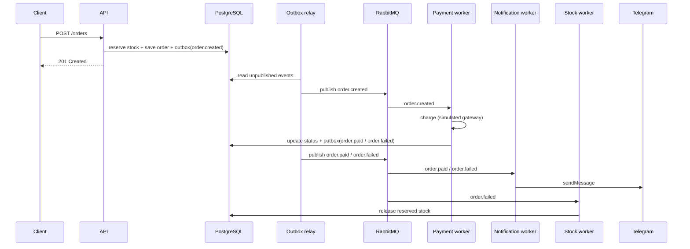
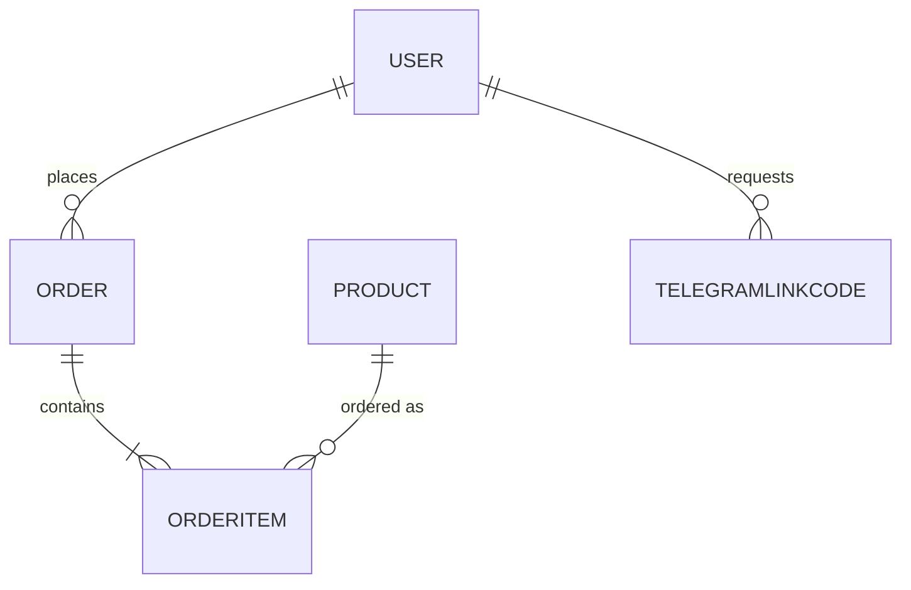

# Order Pipeline

An event-driven order processing backend. An order is accepted in milliseconds; payment, stock handling and customer notifications then happen asynchronously through RabbitMQ, with retries, dead-letter queues and idempotent consumers. The system keeps working when parts of it fail.


<!-- demo video here -->

**Demo (60 s):** an order is placed, the customer gets a Telegram message; RabbitMQ is then stopped, orders are still accepted, and every notification arrives once the broker is back.

## Why this project

Taking payment, reserving stock and notifying a customer inside one HTTP request makes the request slow and fragile: one failing step breaks the whole order. I built this project to practice the standard answer to that problem and, more importantly, the failure modes around it: lost events, duplicate deliveries, retries and concurrent buyers.

The payment gateway is simulated (the failure rate is configurable); everything around it is real.

## How an order flows



## Components

| Component | Responsibility |
|---|---|
| **API** (FastAPI) | Auth, products, orders. Reserves stock and writes the order together with its event in one transaction. Does not talk to RabbitMQ at all. |
| **Outbox relay** | Publishes events from the `outboxevent` table to RabbitMQ and marks them as sent. |
| **Payment worker** | Charges the order through the gateway, updates its status, records the result event. |
| **Stock worker** | Releases reserved stock when an order fails (compensation). |
| **Notification worker** | Tells the customer the result in Telegram. |
| **Telegram bot** | Links a customer's account to a Telegram chat via a one-time deep link. |

## Features

- JWT authentication, admin-only product management, customers can only see their own orders
- Stock reserved atomically at order time; failed payments return the stock
- Prices calculated on the server and copied into each order item, so later price changes do not rewrite history
- Telegram notifications; account linking by a one-time link that expires after 15 minutes
- Alembic migrations, pytest suite, GitHub Actions CI with real PostgreSQL and RabbitMQ

## Engineering decisions

**Transactional outbox.** Saving the order and publishing its event are two writes to two systems with no shared transaction; a crash between them would leave an order that nobody ever processes. Events are therefore written to the database in the same transaction as the business change, and a separate relay publishes them. The API accepts orders even if RabbitMQ is down. *Tests: `test_order_writes_created_event_to_outbox`, `test_order_is_accepted_even_if_broker_is_down`, `test_failed_publish_keeps_event_for_retry`.*

**At-least-once delivery with idempotent consumers.** The relay can publish an event twice (crash after publishing, before marking it sent), and RabbitMQ can redeliver. Every event has a stable `message_id`, and consumers tolerate duplicates: payment uses a conditional `UPDATE ... WHERE status = 'new'`; stock release and notifications record processed message ids (in the same transaction as the effect when it is a database change). *Tests: `test_processing_same_order_twice_charges_once`, `test_duplicate_message_restocks_once`, `test_duplicate_message_notifies_once`.*

**Overselling is prevented by one atomic `UPDATE`.** `UPDATE product SET stock = stock - n WHERE id = ... AND stock >= n` checks and decrements in a single statement. Products are locked in id order to rule out deadlocks, and a rejected order rolls back everything it reserved. *Tests: `test_last_item_is_sold_only_once` (two concurrent requests, exactly one succeeds), `test_not_enough_stock_changes_nothing`.*

**Errors are classified, not just caught.** A declined card is a normal outcome (order fails, stock is released). A gateway timeout is temporary: the message waits in a delay queue and is retried, up to three attempts. A malformed message or an unknown order is permanent and goes to the dead-letter queue immediately.

**Delay queues built from TTL and dead-lettering.** Each consumer queue has a `.retry` queue (messages expire after 5 seconds and return to the main queue) and a `.dlq` queue for messages that need a human.

**Thin events.** Events carry only an `order_id`; consumers read the current state from the database, so they never act on stale data.

**No database connection is held during external calls** (payment gateway, Telegram).

**Secure account linking.** The one-time code is consumed with a single `DELETE ... RETURNING`, so two simultaneous uses cannot both succeed. *Test: `test_link_code_works_only_once`.*

## Reliability: what happens when something fails

| Failure | Behaviour |
|---|---|
| RabbitMQ is down | Orders are still accepted; events wait in the outbox and are delivered after recovery |
| Relay crashes after publishing | The event is published again with the same `message_id`; consumers ignore the duplicate |
| Payment gateway times out | Retried after 5 s, up to 3 attempts, then moved to the DLQ |
| Card is declined | Order is marked `failed`, stock is released, the customer is notified |
| Worker dies while processing | The unacknowledged message returns to the queue; processing is idempotent |
| Duplicate delivery | Skipped by conditional updates or processed-message records |
| Customer blocks the bot | The chat is unlinked, no retries |
| Two buyers, one item left | Exactly one order succeeds |

## Data model



Supporting tables: `outboxevent` (pending events) and `processedmessage` (consumer deduplication).

## RabbitMQ topology

Topic exchange `orders` (durable).

| Queue | Bound to | Consumed by |
|---|---|---|
| `payment.order_created` | `order.created` | payment worker |
| `stock.order_failed` | `order.failed` | stock worker |
| `notification.order_events` | `order.paid`, `order.failed` | notification worker |
| `audit.order_events` | `order.*` | nobody (inspection in the UI, capped) |

Every consumer queue also has `<name>.retry` and `<name>.dlq`.

## API overview

| Method | Path | Access | Description |
|---|---|---|---|
| POST | `/register`, `/login` | public | Create account, get a JWT |
| GET | `/me` | user | Current user |
| POST | `/me/telegram-link` | user | One-time link to connect Telegram |
| GET | `/products`, `/products/{id}` | public | List (paginated) and details |
| POST, PATCH | `/products` | admin | Create and update products |
| POST | `/orders` | user | Create an order |
| GET | `/orders`, `/orders/{id}` | user | Own orders only |

Interactive documentation: `/docs`.

## Tech stack

Python 3.13, FastAPI (async), SQLModel / SQLAlchemy 2 with asyncpg, PostgreSQL 16, Alembic, RabbitMQ with aio-pika, aiogram 3, pytest, Docker Compose, GitHub Actions.

## Project structure

```
app/
├── api/         FastAPI app and routers
├── bot/         Telegram bot (account linking)
├── core/        security, RabbitMQ topology and publishing, payment gateway stub
├── models/      database tables
├── schemas/     request / response models
└── workers/     payment, notification, stock, outbox relay, shared consumer logic
migrations/      Alembic migrations
tests/
```

## Run it

```bash
cp .env.example .env          # fill in the values
docker compose up --build -d
```

API docs: http://localhost:8000/docs · RabbitMQ UI: http://localhost:15672

Make yourself an admin after registering:

```bash
docker compose exec db psql -U postgres -d orders_db \
  -c "UPDATE \"user\" SET is_admin = true WHERE email = 'you@example.com';"
```

Connect Telegram: `POST /me/telegram-link`, open the returned link, press Start.

Run three payment workers: `docker compose up -d --scale payment-worker=3`.

<details>
<summary>Configuration</summary>

| Variable | Purpose |
|---|---|
| `POSTGRES_PASSWORD` | Database password |
| `RABBITMQ_USER`, `RABBITMQ_PASSWORD` | RabbitMQ credentials |
| `SECRET_KEY` | JWT signing key |
| `BOT_TOKEN`, `BOT_USERNAME` | Telegram bot from @BotFather |
| `PAYMENT_ERROR_RATE` | Share of simulated gateway failures (0 to 1) |
| `SQL_ECHO` | Set to `1` to log every SQL statement |

</details>

## Tests and CI

```bash
pip install -r requirements-dev.txt
pytest                  # needs a separate *_test database
pytest -m integration   # needs a running RabbitMQ and no running workers
```

On every push, GitHub Actions applies the migrations to an empty database, runs `alembic check` (fails if a model changed without a migration), runs the test suite, runs the integration test against a real RabbitMQ, and builds the Docker image.

## Next steps

Releasing stock held by orders stuck in `new`, cleaning up published outbox rows, growing retry delays, and Redis caching with rate limiting.